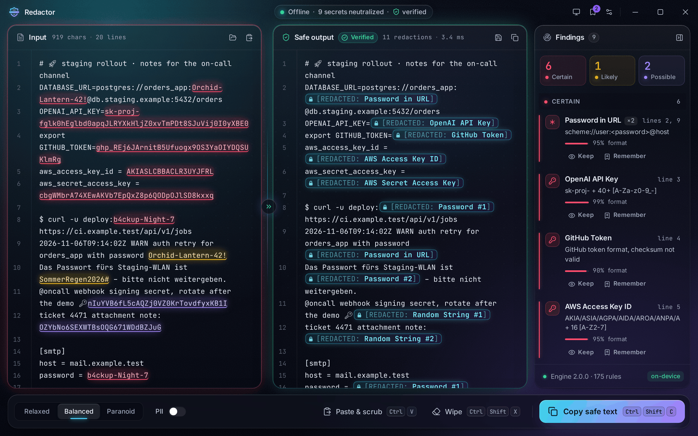
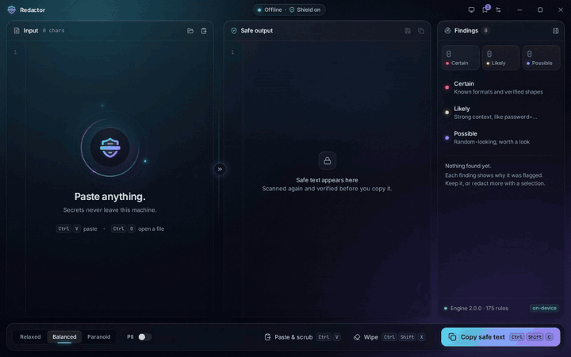
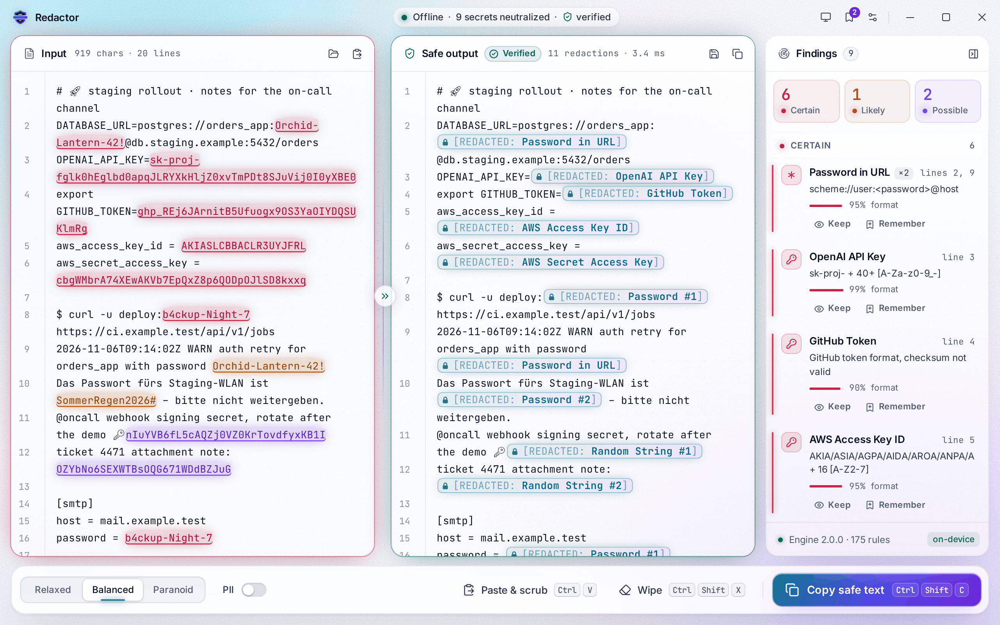

# Redactor

**Strip secrets out of text before you paste it anywhere. Local only.**

[](https://github.com/its30NA/redactor/actions/workflows/ci.yml)
[](https://github.com/its30NA/redactor/releases/latest)
[](LICENSE)

Paste a log, a config file or a terminal session. Redactor finds the passwords, API keys, tokens and
private keys in it and swaps each one for a placeholder like `[REDACTED: Password]`. What is left
is safe to send to a chat assistant, a ticket or a colleague. Nothing leaves your machine: there is no
network code, no account and no telemetry.

<p align="center">
  
</p>

<p align="center">
  
</p>

<details>
<summary>Light theme</summary>
<p align="center"></p>
</details>

All text in the screenshots is synthetic demo data.

## Download

Get the latest build from [GitHub Releases](https://github.com/its30NA/redactor/releases/latest).

| File | What it is |
|---|---|
| `Redactor_<version>_x64-setup.exe` | Windows installer for the desktop app. Per-user, no admin rights needed. |
| `Redactor-v<version>-windows-x64-portable.zip` | The same app as a single `Redactor.exe`, no install. |
| `scrub-v<version>-x86_64-pc-windows-msvc.zip` | The `scrub` command-line tool for Windows. |
| `scrub-v<version>-x86_64-unknown-linux-musl.tar.gz` | `scrub` for Linux (static binary). |
| `scrub-v<version>-aarch64-apple-darwin.tar.gz`, `scrub-v<version>-x86_64-apple-darwin.tar.gz` | `scrub` for macOS (Apple silicon, Intel). |
| `SHA256SUMS` | Checksums of every file above. |

The desktop app is Windows only. `scrub` runs on Windows, Linux and macOS.

The Windows files are not code-signed, so SmartScreen may show "Windows protected your PC". Verify the
download first (below), then choose "More info" and "Run anyway". See the
[threat model](docs/THREAT_MODEL.md#the-unsigned-binary-and-smartscreen) for why that is a limit, not a
formality.

### Verify the download

Every file is built by GitHub Actions from a tagged commit, and the release carries a checksum list and
build provenance attestations.

```bash
# 1. The checksum matches (run in the folder with the downloads)
sha256sum --check --ignore-missing SHA256SUMS
# PowerShell: (Get-FileHash .\<file> -Algorithm SHA256).Hash   and compare with the line in SHA256SUMS

# 2. GitHub signed a statement that this exact file was built by this repository's workflow
gh attestation verify <file> --repo its30NA/redactor
```

Verify `SHA256SUMS` the same way if you want to be sure the checksum list is genuine.

## What it catches

- **Provider tokens:** OpenAI, Anthropic, GitHub, GitLab, AWS, Google, Azure, Stripe, Slack and many more.
- **Credentials in context:** `DB_PASSWORD=...`, `"password": "..."`, `curl -u user:pass`, `mysql -p...`,
  connection strings, HTTP auth headers, and prose such as "the wifi password is ..." in English, German,
  French, Spanish and Persian.
- **Key material:** PEM, OpenSSH and PGP private keys, JWTs, seed phrases, password hashes.
- **Tricks:** secrets split by zero-width characters, wrapped in base64, percent-encoding or JSON escapes,
  and the second and third copy of a secret elsewhere in the text.
- **Optional personal data:** e-mail, phone, IBAN, card numbers, IP addresses, SSN.

The full catalog (170+ rules, each with its pattern and confidence) is in [docs/DETECTORS.md](docs/DETECTORS.md).
Detection is heuristic, so Redactor shows every finding with its reason and lets you keep one, redact
more, or remember a value. Measured recall and false positives are in [docs/ACCURACY.md](docs/ACCURACY.md).

## How it works

```
text -> shadow text -> detectors -> resolver -> placeholders -> verify
```

1. **Shadow text.** Invisible characters (zero-width characters, variation selectors, fillers),
   bidirectional controls and tag characters are removed and Unicode is normalized, with a map back to
   the original, so a token split by zero-width characters is still found.
2. **Detectors.** Provider patterns, a context engine that reads key names, a small trained classifier
   for random-looking tokens, a decode layer for encoded runs, and your own rules and remembered values.
3. **Resolver.** Overlapping hits are merged, never dropped, so no piece of a secret is left behind. A
   value found once is redacted everywhere it appears, also as a base64, hex, percent-encoded or
   JSON-escaped copy.
4. **Placeholders.** One value gets one placeholder wherever it appears, even when different rules found
   its copies, so the output still reads sensibly: a password in a URL and the same password in a log
   line both become `[REDACTED: Password in URL]`.
5. **Verify.** The output is scanned again before it is shown. Anything that still matches is redacted too.

The engine is a pure Rust library with no I/O. The desktop app and `scrub` are thin shells around it. See
[docs/ARCHITECTURE.md](docs/ARCHITECTURE.md).

## Privacy, and how the code keeps its promises

- **Local only.** The app's page may talk to the app's own backend and nothing else. Its content
  security policy allows fetch, XHR and WebSocket connections only to the app's IPC endpoint and loads
  nothing from elsewhere. WebRTC, which that policy does not cover, is removed from the page at start-up,
  and WebView2 starts with non-proxied WebRTC UDP, DNS prefetching and background networking switched
  off. The window is granted only the 14 commands of the app, with no file, shell, HTTP or opener
  permission, and every IPC message must pass an allowlist of the UI's own calls in the isolation frame.
  No HTTP client crate is linked into the Windows app or into `scrub`: `cargo deny` fails the build if one
  appears (`deny.toml`). These limits are checked by tests (`app/src-tauri/tests/config.rs`,
  `app/ui/tests/unit/bundle.test.ts`, `app/ui/tests/unit/isolation.test.ts`). The WebView2 runtime itself
  (a Microsoft component) keeps its own update traffic.
- **No logs.** There is no logging library. A panic never prints its message, because a message could
  quote your text: the app prints nothing, and `scrub` prints one fixed line with the source location and
  exits with code 101. Errors never contain text. The `scrub --audit` log records counts, labels and line
  numbers, never values.
- **Nothing stored.** Scanned text is never written to disk. The only file the app keeps is
  `%APPDATA%\Redactor\settings.json`, which holds settings and your always-redact word list, plain text,
  clearly labeled in the app. Secrets you ask Redactor to remember live in memory only. The window runs
  in WebView2's private mode and the UI has no local storage.
- **Wipes.** Remembered secrets are zeroed in memory when you forget them, quit, lock Windows, put the
  PC to sleep, or after the idle timeout (10 minutes by default). The text panes are cleared at the same
  moments. Zeroing covers the shell's own buffers (remembered secrets, request and clipboard text, opened
  files), not the engine's working copies, Tauri's IPC buffers or JavaScript strings, which cannot be
  wiped; the [threat model](docs/THREAT_MODEL.md#what-is-not-protected) lists exactly what is and is not
  zeroed.
- **Clipboard care.** The `Ctrl+Alt+R` hotkey cleans the clipboard in place. Copies marked private by a
  password manager are never read or changed, and a copy made while the scan runs is never overwritten. The raw copy is removed from Windows clipboard history
  (Win+V) on a best-effort basis.
- **Screen-share shield.** On by default: screenshots and screen sharing see a blank window. This uses a
  Windows display setting and is best effort, not a guarantee.
- **Memory safety.** `redactor-core`, `redactor-wire` and `scrub` forbid `unsafe` code. In the app it is
  confined to the Windows modules, each block with a safety comment. Detection uses the `regex` crate,
  which runs in linear time, and the rest of the engine scales linearly with the size of the input too,
  so crafted input cannot stall it. A release test (`adversarial_shapes_scale_linearly`,
  `crates/redactor-core/tests/perf.rs`) times long lines, unterminated blocks, many distinct values,
  nested encodings and similar shapes; the slowest runs at about 3.5 MiB/s.

What Redactor does not protect against is written down in [docs/THREAT_MODEL.md](docs/THREAT_MODEL.md).
In short: another program running as you can read the window while it is open.

## CLI quick start

```bash
scrub app.log                       # redacted text on stdout
cat app.log | scrub                 # or from a pipe
scrub app.log --summary             # counts per label on stderr
scrub app.log --preview             # where each redaction happened (values masked)
scrub scan .                        # report secrets in a folder, exit 1 if any
scrub scan . --write                # rewrite files in place with placeholders
scrub install-hook                  # block commits that contain secrets
scrub clipboard                     # clean the clipboard in place (Windows)
scrub --sensitivity paranoid --pii  # flag more
scrub detectors                     # list every rule
```

Every command and the config file are described in the [user guide](docs/GUIDE.md).

## Build from source

You need Rust 1.99 (`rust-toolchain.toml` selects it), and Node 22 for the app's UI.

```bash
# CLI and engine (any platform)
cargo build --release -p scrub          # target/release/scrub
cargo test --workspace

# Desktop app (Windows)
cd app/ui && npm ci && npm run build    # the Tauri build embeds the built UI
cd ../src-tauri && ../ui/node_modules/.bin/tauri build --bundles nsis
```

[CONTRIBUTING.md](CONTRIBUTING.md) has the full test and lint commands.

## Documentation

[User guide](docs/GUIDE.md) · [Architecture](docs/ARCHITECTURE.md) · [Threat model](docs/THREAT_MODEL.md) ·
[Detectors](docs/DETECTORS.md) · [Accuracy](docs/ACCURACY.md) · [Harsh test cases](docs/HARSH_TESTS.md) ·
[Security policy](SECURITY.md) · [Changelog](CHANGELOG.md)

## License

[MIT](LICENSE). Copyright (c) 2026 Sina Kashani.
